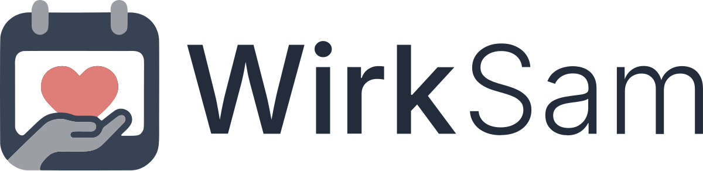
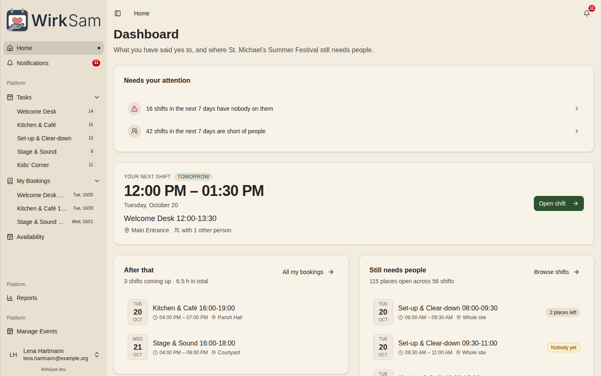
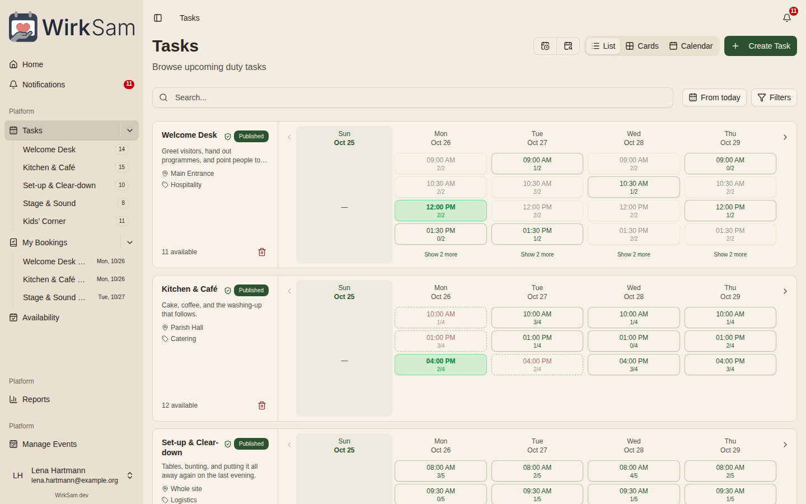
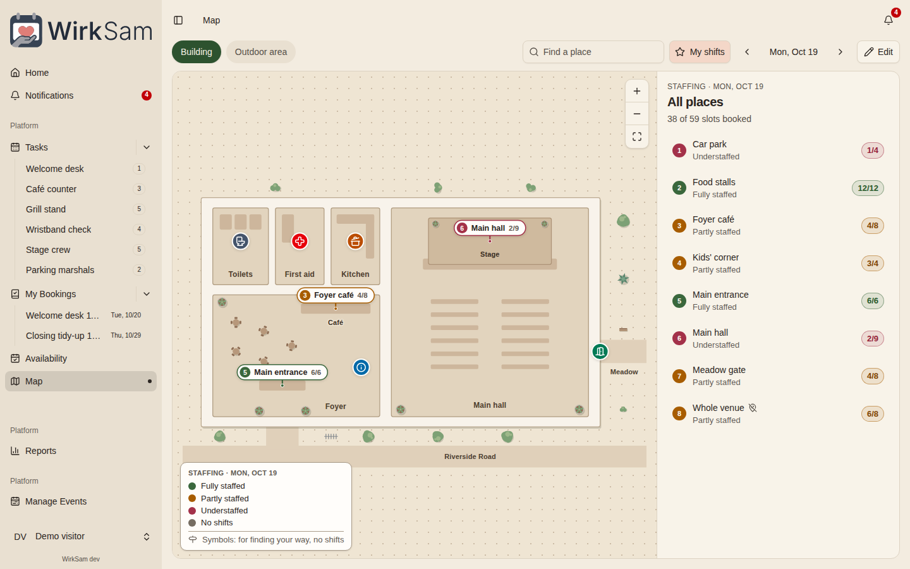
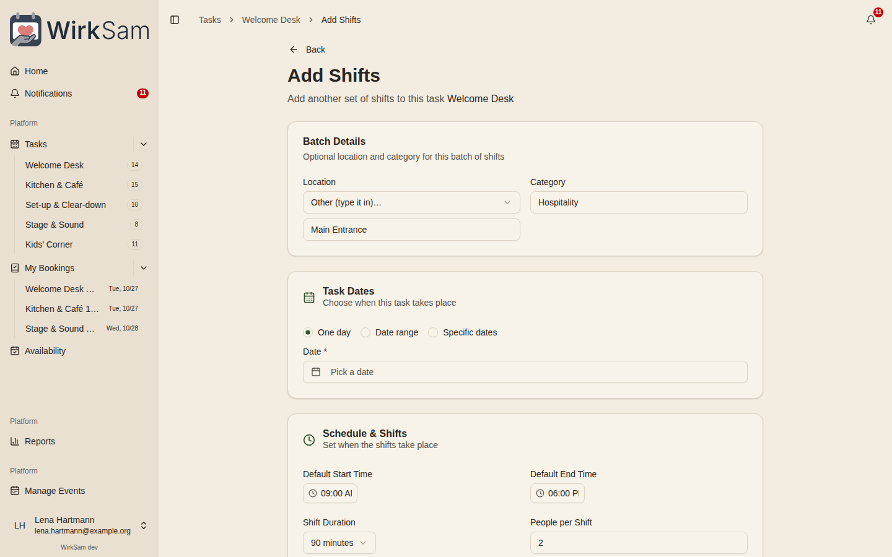

<p align="center">
  <picture>
    <source media="(prefers-color-scheme: dark)" srcset="frontend/src/assets/logo/wirksam-light.svg" />
    <source media="(prefers-color-scheme: light)" srcset="frontend/src/assets/logo/wirksam-dark.svg" />
    
  </picture>
</p>

<p align="center">
  Free shift planning for volunteers at events, in clubs, congregations and other groups.
</p>

<p align="center">
  <a href="https://wirksam.app">wirksam.app</a> ·
  <a href="https://wirksam.app/changelog">Changelog</a> ·
  <a href="https://wirksam.app/alternatives">Compared with other tools</a> ·
  <a href="https://wirksam.app/de">Deutsch</a>
</p>

---

WirkSam is a web app for planning who works when at a volunteer event. An
organiser sets up the event, describes each job once (the days, the hours, how
long a shift lasts and how many people it needs), and WirkSam creates the
shifts from that. Helpers join through an invitation link, book the shifts that
suit them and get a reminder before each one.

It is free and non-commercial, has no tracking or ads, and runs in English and
German. You can use the hosted version at [wirksam.app](https://wirksam.app) or
run it on your own server.

To look around without an account, open [wirksam.app](https://wirksam.app) and
choose **Try a demo event**. You get an example event, as a helper or as the
organiser, and it is deleted again after an hour.

## Screenshots

<picture>
  <source media="(prefers-color-scheme: dark)" srcset="frontend/public/screenshots/en/dashboard-dark.png" />
  
</picture>

<picture>
  <source media="(prefers-color-scheme: dark)" srcset="frontend/public/screenshots/en/tasks-dark.png" />
  
</picture>

<picture>
  <source media="(prefers-color-scheme: dark)" srcset="frontend/public/screenshots/en/venue-map-dark.png" />
  
</picture>

<picture>
  <source media="(prefers-color-scheme: dark)" srcset="frontend/public/screenshots/en/shift-schedule-dark.png" />
  
</picture>

More screenshots, in English and German and in light and dark, are in
[`frontend/public/screenshots`](frontend/public/screenshots).

## Features

- Shifts generated from a pattern: days, daily hours, shift length and people per shift. You can adjust single days or leave shifts out.
- Helpers book their own shifts and see them in one list. WirkSam refuses a booking that overlaps one they already have.
- Reminders before every shift by email, browser push or Telegram, whichever the helper reads.
- Availability: collect who can be there when before you assign anything.
- A venue map. Upload a floor plan or draw the venue in the app, pin each place where people work, and see how well each one is staffed.
- Calendar subscription for Google Calendar, Apple Calendar and Outlook.
- Hours worked per volunteer, counted from their shifts, with a CSV export.
- Reports on how the work is spread, and printable rosters per job or for the whole event.
- Copy last year's event onto new dates, with its jobs, shifts and times.
- Roles per event (owner, organisers, members), private or public events, and join requests for public ones.
- English and German, light and dark, usable on a phone.

## Running it yourself

WirkSam is a FastAPI backend with PostgreSQL and a Vue frontend, packaged with
Docker Compose. [`docs/deployment.md`](docs/deployment.md) describes a
production setup behind Traefik, including the environment variables. Before a
deployment, replace every `changethis` in `.env`; this prints a suitable key:

```bash
python -c "import secrets; print(secrets.token_urlsafe(32))"
```

Set `SUPERADMIN_EMAILS` to your address, or the deployment has no
administrator. Who may sign up is controlled by `REGISTRATION_MODE`; see
[`docs/AUTH.md`](docs/AUTH.md#who-may-register).

### Local development

You need Docker, [uv](https://docs.astral.sh/uv/), [pnpm](https://pnpm.io),
Node.js and [just](https://github.com/casey/just).

```bash
cp .env.example .env
cp frontend/.env.example frontend/.env
just dev
```

This starts the database in Docker, runs the migrations, seeds a few demo
events and starts backend and frontend. The app is at
`http://wirksam.localhost:47300` and the API docs at
`http://wirksam.localhost:47301/docs`. Sign in as `dev@example.com` with the
password `devpassword`.

More in [`docs/development.md`](docs/development.md),
[`backend/README.md`](backend/README.md) and
[`frontend/README.md`](frontend/README.md).

## Technology

- Backend: [FastAPI](https://fastapi.tiangolo.com), [SQLModel](https://sqlmodel.tiangolo.com) (async SQLAlchemy), [PostgreSQL](https://www.postgresql.org), [Alembic](https://alembic.sqlalchemy.org/) migrations, built-in JWT authentication ([docs/AUTH.md](docs/AUTH.md))
- Frontend: [Vue 3](https://vuejs.org), TypeScript, [Vite](https://vite.dev), [Pinia](https://pinia.vuejs.org), [Vue Router](https://router.vuejs.org), [Tailwind CSS v4](https://tailwindcss.com), [shadcn-vue](https://www.shadcn-vue.com/), [Vue I18n](https://vue-i18n.intlify.dev)
- Tests: [Pytest](https://pytest.org) for the backend, [Playwright](https://playwright.dev) end to end
- Infrastructure: [Docker Compose](https://www.docker.com), [Traefik](https://traefik.io), GitHub Actions

WirkSam started from a full-stack FastAPI and Vue template. Notes on using it as
a template for your own project are in [`docs/TEMPLATE.md`](docs/TEMPLATE.md).

## Screenshots for the website and this README

The screenshots come from a script, so they can be regenerated after a UI
change instead of retaken by hand. They need the backend on port 8787 with
`TESTING=true` and the frontend on port 5555 with `VITE_E2E_AUTH_BYPASS=true`:

```bash
just screenshots      # English
just screenshots de   # German
```

A GitHub workflow does the same after each release and opens a pull request
with the new images.

## License

WirkSam is licensed under the [MIT License](./LICENSE).
